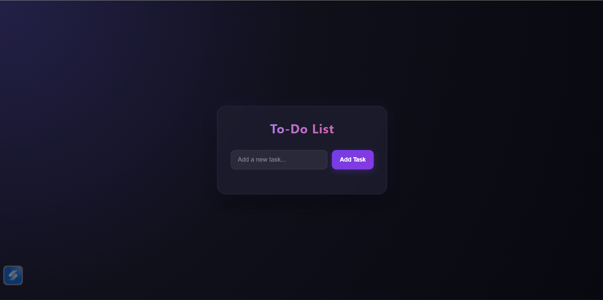
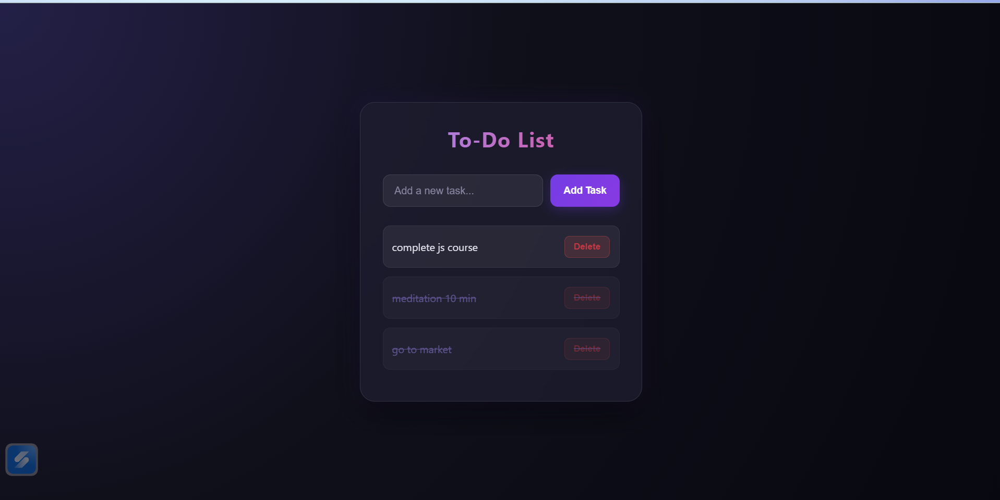
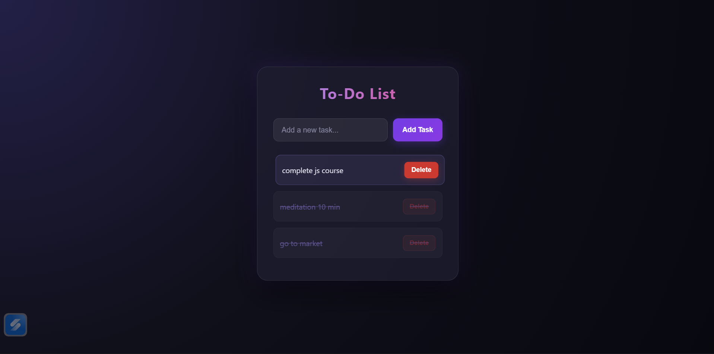

# To-Do List — Local Storage

A simple and elegant To-Do List application built using **HTML, CSS, and Vanilla JavaScript**. Manage your daily tasks, mark them as completed, and delete tasks when they're no longer needed.

## Features

- **Add Tasks:** Add new tasks through the input field.
- **Complete Tasks:** Click a task to mark it as completed or undo completion.
- **Delete Tasks:** Remove tasks you no longer need.
- **Persistent Storage:** Tasks are saved using browser `localStorage`.
- **Responsive Design:** Works on desktop and mobile screens.
- **Dark UI:** Modern dark-themed interface with glassmorphism styling.

## Technologies Used

- HTML5 — Application structure
- CSS3 — Styling, animations, gradients and responsive design
- JavaScript (ES6+) — DOM manipulation and application logic
- localStorage — Persistent browser storage

## Preview





## Getting Started

### 1. Clone the repository

```bash
https://github.com/soumyajitsinha/todo-list-local-storage.git
```

### 2. Navigate to the project folder

```bash
cd todo-list-local-storage
```

### 3. Run the application

Open `index.html` in your browser.

You can also use the Live Server extension in Visual Studio Code.

## 📂 Project Structure

```text
todo-list-local-storage/
│
├── index.html
├── styles.css
├── script.js
├── README.md
└── assets/
    └── screenshot.png
```

## Concepts Practiced

This project helped me practice:

- DOM Manipulation
- Event Listeners
- JavaScript Objects and Arrays
- Arrow Functions and Callbacks
- Array Methods (`forEach`, `push`, `filter`)
- Template Literals
- JSON (`JSON.stringify` and `JSON.parse`)
- Browser localStorage
- Event Bubbling and `stopPropagation()`

## Future Improvements

- Add task editing functionality.
- Add task filters (All, Active, Completed).
- Add task creation dates.
- Add a clear-all-tasks option.

